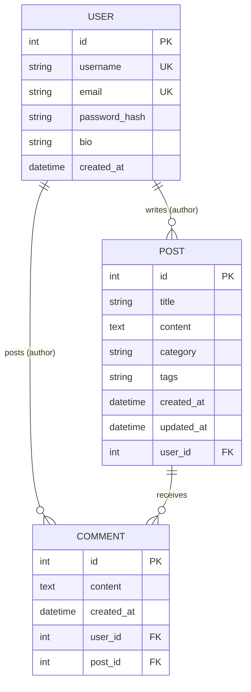

# Chronicle - Modern Blogging Platform with Python Flask

A complete, full-stack, responsive Blogging Platform web application built with **Python 3**, **Flask**, **SQLite**, **Flask-SQLAlchemy**, **Flask-Login**, **Flask-WTF**, and **Bootstrap 5**.

---

## 1. Project Overview

Chronicle is a full-featured publishing and discussion platform where authors can write, edit, and categorize stories, while readers can search, discover, and comment on articles in real time. The project includes user authentication, role-based access control, relational database architecture, a REST API with JSON responses, automated test coverage, and a responsive frontend.

---

## 2. Technologies Used

| Layer | Technology |
|---|---|
| **Backend Framework** | Python 3.12, Flask 3.0 |
| **Database** | SQLite3 |
| **ORM** | Flask-SQLAlchemy 3.1 / SQLAlchemy 2.0 |
| **Authentication** | Flask-Login & Werkzeug Security (Scrypt password hashing) |
| **Forms & Validation** | Flask-WTF & WTForms (CSRF Protection enabled) |
| **Database Migrations** | Flask-Migrate & Alembic |
| **Frontend Template Engine** | Jinja2 |
| **UI Styling & Icons** | HTML5, CSS3, Bootstrap 5.3, Bootstrap Icons, Google Fonts |
| **Testing** | Python `unittest` |
| **Environment Config** | `python-dotenv` |

---

## 3. Project Folder Structure

```
blogging_platform/
│
├── app/
│   ├── __init__.py          # Application factory, extensions initialization, error handlers
│   ├── models.py            # Database models (User, Post, Comment)
│   ├── forms.py             # WTForms (Registration, Login, PostForm, CommentForm, Profile)
│   ├── routes/
│   │   ├── __init__.py
│   │   ├── auth.py          # Register, login, logout, profile routes
│   │   ├── posts.py         # Blog CRUD routes & comment submissions
│   │   ├── main.py          # Home, search, dashboard routes
│   │   └── api.py           # REST API endpoints (GET, POST, PUT, DELETE)
│   ├── templates/
│   │   ├── base.html        # Main layout (Navbar, flash messages, footer)
│   │   ├── index.html       # Homepage with article feed, categories & filters
│   │   ├── login.html       # User sign-in card
│   │   ├── register.html    # User registration card
│   │   ├── dashboard.html   # Author analytics & post management dashboard
│   │   ├── create_post.html # Article publishing editor with live counter
│   │   ├── edit_post.html   # Post editing view (author protected)
│   │   ├── post_detail.html # Full article, author bio & commenting section
│   │   ├── profile.html     # Author public profile & bio editor
│   │   ├── search.html      # Advanced search & tag/category filtering
│   │   └── errors/
│   │       ├── 403.html     # 403 Forbidden page
│   │       ├── 404.html     # 404 Not Found page
│   │       └── 500.html     # 500 Server Error page
│   └── static/
│       ├── css/
│       │   └── style.css    # Custom typography, cards, badges & animations
│       └── js/
│           └── script.js    # Interactive features, reading progress & alerts
│
├── instance/                # SQLite database folder (auto-created)
│   └── blog.db
├── migrations/              # Database migration versions
├── .env.example             # Template for environment variables
├── .gitignore               # Git ignore rules for venv, database, and cache
├── config.py                # Application configuration & category constants
├── requirements.txt         # Project Python package dependencies
├── run.py                   # Development server entry point
├── seed.py                  # Demo database generator (users, posts, comments)
├── test_app.py              # Automated test suite (6 tests covering all features)
└── README.md                # Project documentation
```

---

## 4. Database Schema

The database utilizes three relational models with cascade deletion:



---

## 5. Quick Installation & Execution Guide

Follow these beginner-friendly steps to run the application on your computer:

### Step 1: Open Terminal in Project Directory
Navigate into the project root directory:
```bash
cd "blogging platform 2"
```

### Step 2: Create and Activate a Virtual Environment
**On Windows:**
```powershell
python -m venv venv
.\venv\Scripts\activate
```

**On macOS / Linux:**
```bash
python3 -m venv venv
source venv/bin/activate
```

### Step 3: Install Required Dependencies
```bash
pip install -r requirements.txt
```

### Step 4: Populate Sample Data (Optional but Recommended)
Run the built-in database seeder to populate realistic demo authors, articles across categories, and comments:
```bash
python seed.py
```

### Step 5: Start the Flask Development Server
```bash
python run.py
```

Open your browser and navigate to:
**http://127.0.0.1:5000**

---

## 6. Pre-Configured Demo Accounts

After running `python seed.py`, the following demo accounts are available:

| Username | Email | Password | Role |
|---|---|---|---|
| `alex_dev` | alex@example.com | `password123` | Full-stack Engineer |
| `sarah_ai` | sarah@example.com | `password123` | AI Researcher |
| `elena_design` | elena@example.com | `password123` | Product Designer |
| `marcus_lead` | marcus@example.com | `password123` | Engineering Manager |

*You can also register a new account anytime via the "Get Started" button on the website.*

---

## 7. REST API Documentation

Chronicle provides a JSON REST API for third-party integration or mobile clients.

### Endpoints Overview

| Method | Endpoint | Description | Auth Required |
|---|---|---|---|
| `GET` | `/api/posts` | List posts with pagination, search, category & tag filters | No |
| `GET` | `/api/posts/<id>` | Retrieve full post details and comments | No |
| `POST` | `/api/posts` | Create a new blog post | Yes (Session / Basic Auth) |
| `PUT` | `/api/posts/<id>` | Update an existing post | Yes (Author Only) |
| `DELETE` | `/api/posts/<id>` | Delete a blog post | Yes (Author Only) |
| `GET` | `/api/categories` | List all categories with post counts | No |

### API Request Examples

#### 1. Fetch All Posts (with optional filters)
```bash
curl -X GET "http://127.0.0.1:5000/api/posts?category=Programming&limit=5"
```
**Sample JSON Response:**
```json
{
  "success": true,
  "total": 1,
  "page": 1,
  "pages": 1,
  "per_page": 5,
  "posts": [
    {
      "id": 1,
      "title": "Mastering Python 3.12: The Most Exciting Features & Performance Boosts",
      "category": "Programming",
      "tags": ["python", "backend", "programming"],
      "reading_time_minutes": 2,
      "comments_count": 2,
      "author": {
        "id": 1,
        "username": "alex_dev"
      }
    }
  ]
}
```

#### 2. Create Post via API (Basic Auth)
```bash
curl -X POST "http://127.0.0.1:5000/api/posts" \
     -u alex_dev:password123 \
     -H "Content-Type: application/json" \
     -d '{
       "title": "Automating Deployments with Docker and Flask",
       "category": "Web Development",
       "tags": "devops, docker, flask",
       "content": "Containerizing a Flask application ensures consistency across environments."
     }'
```

#### 3. Update Post via API
```bash
curl -X PUT "http://127.0.0.1:5000/api/posts/1" \
     -u alex_dev:password123 \
     -H "Content-Type: application/json" \
     -d '{
       "title": "Mastering Python 3.12: Updated Guide"
     }'
```

#### 4. Delete Post via API
```bash
curl -X DELETE "http://127.0.0.1:5000/api/posts/1" \
     -u alex_dev:password123
```

---

## 8. Automated Testing

The project includes a comprehensive automated test suite (`test_app.py`) that tests models, authentication, authorization checks, comments, search filters, and the REST API using an in-memory SQLite database.

To run the test suite:
```bash
python test_app.py
```

Expected output:
```
Ran 6 tests in 3.055s
OK
```

---

## 9. 8-Week Internship Task Mapping

This repository covers all deliverables specified in the 8-week curriculum:

| Week | Task | Implementation in Codebase |
|---|---|---|
| **Week 1** | **Flask Setup** | App factory in `app/__init__.py`, `config.py`, `run.py`, responsive homepage in `index.html`. |
| **Week 2** | **Authentication** | `app/routes/auth.py`, `User` model, Scrypt password hashing, login/logout, `@login_required`. |
| **Week 3** | **Blog CRUD** | `app/routes/posts.py`, `Post` model, create, view, edit, delete routes with 403 author verification. |
| **Week 4** | **Frontend** | Modern Bootstrap 5 layout, glass navbar, custom `style.css`, clean responsive cards, user dashboard. |
| **Week 5** | **Comments** | `Comment` model, nested discussions under posts, owner comment deletion, `CommentForm`. |
| **Week 6** | **Search & Filters** | Search by keyword (title/content), filter by category & tags in `main.py` & `search.html`. |
| **Week 7** | **Testing & Security** | Automated test suite in `test_app.py`, CSRF protection, `.env.example`, REST API with status codes. |
| **Week 8** | **Documentation & Video** | Comprehensive `README.md`, Git setup, live seed data generator for video demonstration. |

---

## 10. How to Upload to GitHub

Follow these steps to publish this project to your GitHub profile:

```bash
# 1. Check git status
git status

# 2. Stage all project files
git add .

# 3. Commit the files
git commit -m "feat: complete blogging platform with Flask, SQLite, and REST API"

# 4. Create a new repository on GitHub (e.g. 'flask-blogging-platform')
# Then link your local repository:
git remote add origin https://github.com/YOUR_USERNAME/flask-blogging-platform.git

# 5. Push to GitHub
git branch -M main
git push -u origin main
```

---

## 11. Production Deployment Notes

To deploy on platforms like **Render**, **Railway**, or **PythonAnywhere**:
1. Add `gunicorn` to `requirements.txt`:
   ```bash
   pip install gunicorn
   ```
2. Create a `Procfile` for platforms like Render / Heroku:
   ```text
   web: gunicorn "app:create_app()"
   ```
3. Set production environment variables:
   - `SECRET_KEY`: Set to a strong random 32-character string.
   - `FLASK_DEBUG`: Set to `False`.
   - `DATABASE_URL`: Set to PostgreSQL or keep local persistent SQLite.

---

## 12. License
This project is open-source under the MIT License.
